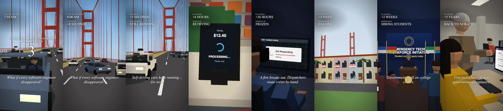

# What-If Video: a Claude skill for vertical scenario videos

Make short vertical "What if…" videos (Reels, TikTok, Shorts) entirely in code: a PS2-style low-poly 3D world, readable serif captions and stat labels, a 5-4-3-2-1 countdown hook, BREAKING news banners, and fully synthesized sound effects, rendered to 1080×1920 or 4K MP4.



*Frames from `examples/what-if-engineers`: "What if every software engineer disappeared?" (73.5 s, 18 beats).*

This repo is both:

- a **Claude skill** (`SKILL.md` + `references/`) that teaches Claude Code the full workflow, from script to beat sheet, scenes, sound, render and revisions, and
- a **starter project** (`template/`) plus the **complete worked example** (`examples/what-if-engineers/`) you can run by hand.

## Tech stack

| Layer | Tool | Why |
|---|---|---|
| Video engine | [Remotion](https://www.remotion.dev/) 4.0.535 | React → video, frame-exact timing, MP4 encode, `--scale=2` for 4K |
| 3D | [React Three Fiber](https://r3f.docs.pmnd.rs/) 9 + [three.js](https://threejs.org/) 0.186 via `@remotion/three` | Every set, prop and camera is code: perfect continuity and cheap revisions |
| Look | Half-resolution WebGL upscaled with pixelated filtering, flat-shaded Lambert materials, linear fog | PS2-era aesthetic that's fast to build and forgiving |
| Screens | 2D canvas textures | Phones, monitors, terminals, signs and charts with animated UI |
| Text overlay | HTML/CSS (serif, shadow, thin dark outline) | Sharp at any resolution |
| Sound | Python + numpy/scipy synthesis (55 original recipes) | No samples, no licensing; cues locked to beats |
| Mastering and checks | ffmpeg (loudnorm to about -14 LUFS, ebur128, contact sheets) | Platform-ready loudness and quick verification |

## Requirements

- Node.js 20+ and npm
- Python 3.10+ with `numpy` and `scipy` (`pip install numpy scipy`)
- ffmpeg on your PATH (`brew install ffmpeg` on macOS)
- macOS, Linux or Windows; Remotion downloads its own headless Chromium on first render. On macOS, WebGL uses ANGLE (already configured).

## Install as a Claude Code skill

```bash
# personal skill, available in every project
git clone git@github.com:BinhL3/what-if-video-skill.git ~/.claude/skills/what-if-video
```

Or copy the folder into a project's `.claude/skills/what-if-video/` so it travels with that repo. Claude picks it up automatically; just ask for something like:

> Make a 60-second vertical "what if" video: what if every barista disappeared? PS2 style, captions, no narration.

Claude will draft a beat sheet with you, copy `template/`, build the scenes, check stills, synthesize the sound, render, and iterate on your feedback.

## Quick start by hand

```bash
cp -r template my-video && cd my-video
npm install
npm run sound          # synthesize public/soundtrack.wav (required before any render)
npm run stills         # middle frame of each beat → out/stills/sheet.png
npm run studio         # optional: interactive preview in the browser
npm run render         # out/video.mp4    (1080×1920, 30 fps)
npm run render:4k      # out/video-4k.mp4 (2160×3840)
```

The template ships a 10-second demo (an office worker vanishes on a countdown, then the inbox piles up) so you can see every system working before you replace it.

## How a video is put together

1. **`beats.json` is the timeline.** Each beat has an id, a length in frames, captions, stat labels, and optionally a countdown or BREAKING banner. Picture and sound both read it, so adding, removing, moving or lengthening a beat is a one-file edit.
2. **`src/scenes/`** has one component per beat id. Each builds its set from the primitives in `src/three/` (people with poses, cars, desks, monitors, laptops, phones, particle bursts) and places one camera.
3. **`src/screens.ts`** draws the in-world screens (chat apps, error terminals, listings, dashboards) on 2D canvases.
4. **`src/Video.tsx`** layers the 3D, the text overlay, the countdown, banners, the fade to black, and the soundtrack.
5. **`scripts/soundtrack.py`** places synthesized effects with `at("beat-id", seconds)` and masters the mix; `scripts/sfx.py` is the effects library.
6. **`scripts/stills.mjs`** renders chosen frames and tiles them into a contact sheet. Look at it after every change.

Details for each step are in `references/`:

| File | Read it for |
|---|---|
| `references/story.md` | Beat structure, caption rules, stat labels, countdown hook, premise and realism checks, brand rules |
| `references/architecture.md` | Project layout, `beats.json` format, scene registry, overlay |
| `references/scenes.md` | Primitives catalogue, 9:16 camera framing rules, PS2 look, screens, lighting, common bugs |
| `references/sound.md` | Effects catalogue, cue placement, mix levels, loudness |
| `references/rendering.md` | Stills, full and 4K renders, verification, delivery |

## Repo layout

```
SKILL.md                         skill entry point (workflow for Claude)
references/                      detailed guides loaded as needed
template/                        starter project, copied for each new video
examples/what-if-engineers/      the full 18-beat example project
docs/preview.jpg                 README image
```

## The example project

`examples/what-if-engineers/` produced the video in the preview: countdown → empty driver's seat on the Golden Gate Bridge → interviewer vanishes → robotaxi keeps driving → on-call page nobody answers → expired-certificate payment failure → cloud outage → apartment fire with hand-routed dispatch → stock crash → handwritten boarding passes and cash only → Marina rent drop → local AI makes a fix worse → governments recruit students → retirees and AI tutors teach → students rebuild → five years later.

It predates the `beats.json` timeline, so its timing uses frame-remapping layers (`SEGMENTS`, `toV3`/`toV4` in `src/Video.tsx`; `M()`/`S()` in `scripts/soundtrack.py`). Borrow its scenes freely, but start new videos from `template/`. To render it:

```bash
cd examples/what-if-engineers
npm install
python3 scripts/soundtrack.py
mv public/soundtrack.wav public/st_raw.wav && ffmpeg -y -i public/st_raw.wav -af "loudnorm=I=-15:TP=-1.5:LRA=14,volume=4dB,alimiter=limit=0.84:level=false" -ar 48000 public/soundtrack.wav && rm public/st_raw.wav
npx remotion render src/index.ts WhatIf out/what-if-engineers.mp4 --codec=h264 --crf=18
```

## Notes

- All UIs, brands, prices and statistics in the example are fictional look-alikes or invented numbers; keep it that way for new videos (see `references/story.md`).
- Every sound is synthesized; no third-party audio is included.
